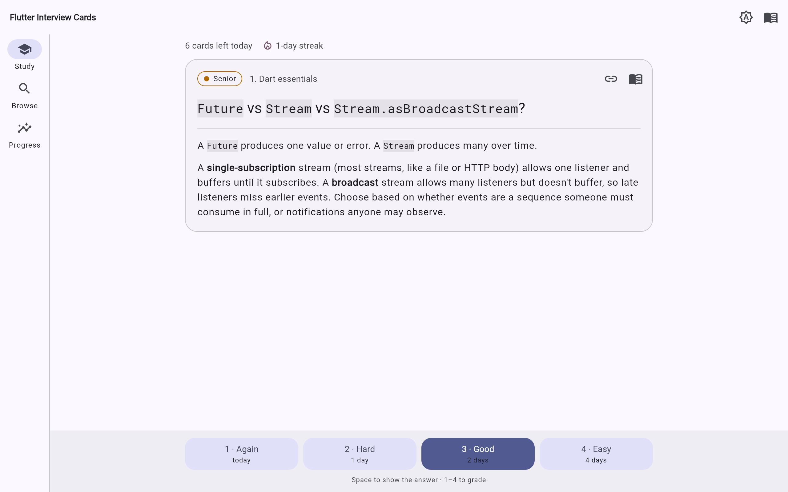
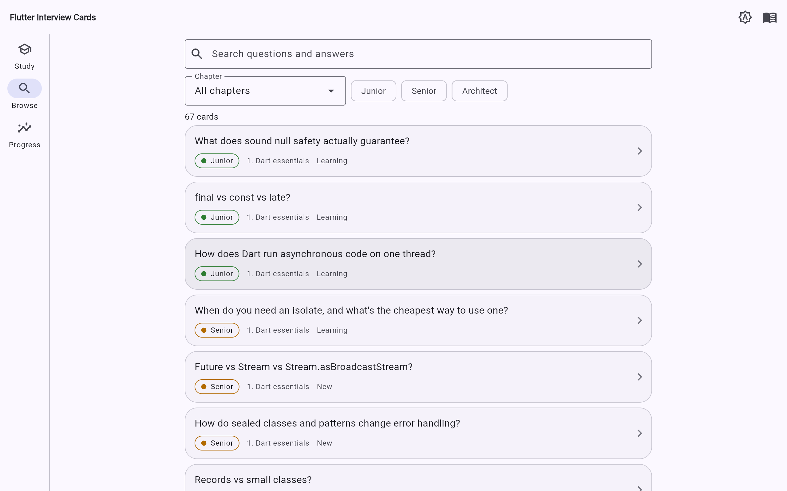
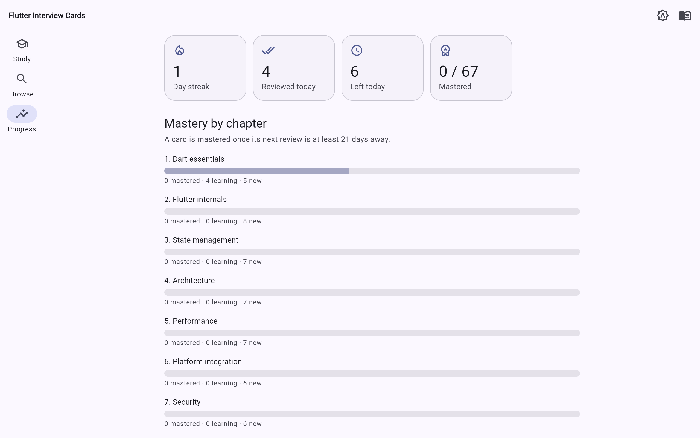
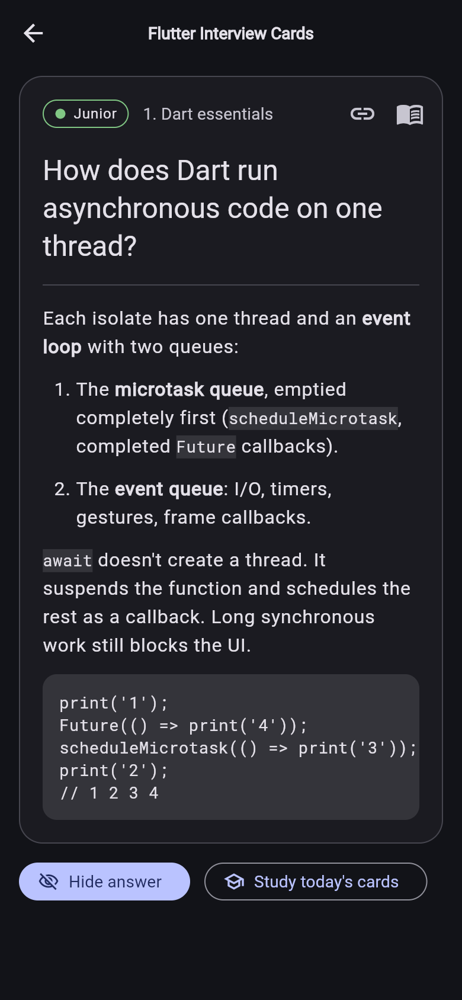

# Flutter Interview Cards

[](https://github.com/ChandraChaan/flutter-interview-cards/actions/workflows/ci.yml)
[](https://chandrachaan.github.io/flutter-interview-cards/)
[](https://flutter.dev)
[](LICENSE)

**Practise 67 Flutter interview questions, from junior to architect, with spaced-repetition flashcards.**

### ▶ [Open the app](https://chandrachaan.github.io/flutter-interview-cards/)

No sign-up, no ads, no tracking. Your progress stays in your browser.



## Why

Reading interview answers feels like learning, but you only find out what stuck when you have to say it out loud. Flashcards make you answer **before** you see the answer, and spaced repetition brings each question back just before you'd forget it. Ten minutes a day is enough to work through the whole deck in about a week and keep it fresh until your interview.

## Built from the Flutter Architect Handbook

Every card is a question from the [**Flutter Architect Handbook**](https://github.com/ChandraChaan/flutter-architect-handbook), a free, MIT-licensed guide that covers Dart, Flutter internals, state management, architecture, performance, platform integration, security, testing, mobile system design and technical leadership.

| | Handbook | Flashcards |
|---|---|---|
| Best for | Reading a topic end to end | Remembering it |
| Format | 10 Markdown chapters | 67 cards, one per question |
| Levels | 🟢 Junior · 🟡 Senior · 🔴 Architect | Filter by level and chapter |

Each card links back to its section in the handbook, and the cards are generated from the handbook's Markdown, so a fix there reaches the app on the next import. Spotted a wrong or outdated answer? Please [open an issue in the handbook](https://github.com/ChandraChaan/flutter-architect-handbook/issues).

## Features

- **Spaced repetition.** Grade each card *Again*, *Hard*, *Good* or *Easy*; each button shows when you'll see the card next. A daily queue mixes due cards with up to 10 new ones.
- **Browse and search** all 67 questions, filtered by chapter and level.
- **Progress:** daily streak, cards reviewed today, and mastery bars for each chapter. Reset any time.
- **Share a question.** Every card has its own link, like [`#/card/final-vs-const-vs-late`](https://chandrachaan.github.io/flutter-interview-cards/#/card/final-vs-const-vs-late).
- **Keyboard shortcuts** on the web: <kbd>Space</kbd> shows the answer, <kbd>1</kbd>–<kbd>4</kbd> grade it.
- **Dark mode**, phone-sized layouts, and real code blocks in answers.

| Browse | Progress | On a phone, in dark mode |
|---|---|---|
|  |  |  |

## How the scheduling works

The scheduler is a small variant of [SM-2](https://en.wikipedia.org/wiki/SuperMemo#Description_of_SM-2_algorithm), in [`scheduler.dart`](lib/features/review/domain/scheduler.dart):

- A new card comes back the same day (*Again*), or in 1, 2 or 4 days.
- After that, *Good* multiplies the interval by the card's ease (starting at 2.5), *Hard* grows it by about 20%, and *Easy* by a further 30%. *Again* resets it and lowers the ease.
- Days are calendar days: a card due tomorrow is due all of tomorrow, whatever time you studied today.
- A card counts as **mastered** once its next review is at least 21 days away.

## Run it locally

```bash
git clone --recurse-submodules https://github.com/ChandraChaan/flutter-interview-cards
cd flutter-interview-cards
flutter run -d chrome
```

It also builds for Android (`flutter run -d android`).

## Updating the cards

The handbook is pinned as a git submodule in [`third_party/`](third_party), and [`tool/import_handbook.dart`](tool/import_handbook.dart) turns its chapters into [`assets/cards.json`](assets/cards.json):

```bash
git -C third_party/flutter-architect-handbook pull origin main
dart run tool/import_handbook.dart
```

CI runs the importer with `--check`, so the app can't drift from the pinned handbook commit. The importer fails loudly, naming the file and line, if a chapter doesn't follow the handbook's format.

## Project structure

Feature-first folders with `domain`, `data` and `presentation` layers, Riverpod 3 for state and go_router for links:

```
lib/
  core/                 theme, router, links, shared widgets
  features/
    deck/               cards and chapters, loaded from the JSON asset
    review/             scheduler, saved progress, the study screen
    browse/             search and filters
    card/               a single shared card
    progress/           streak and mastery
tool/                   the handbook importer
test/                   importer, scheduler, persistence and widget tests
```

```bash
dart format .
flutter analyze
flutter test
```

## Contributing

Issues and pull requests are welcome, especially for accessibility, new study modes and anything that makes practising easier. For the questions and answers themselves, contribute to the [handbook](https://github.com/ChandraChaan/flutter-architect-handbook) and the cards will follow. Questions and ideas go in [Discussions](https://github.com/ChandraChaan/flutter-interview-cards/discussions).

If the cards help you prepare, a ⭐ helps other Flutter developers find them.

## License

[MIT](LICENSE) © Chandra ObulaReddy. The bundled Roboto Mono font is under the [SIL Open Font License](assets/fonts/OFL.txt).
